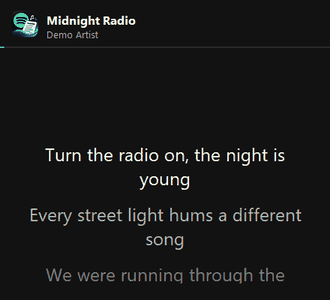
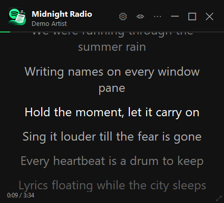
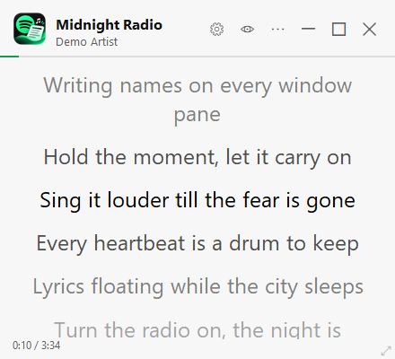
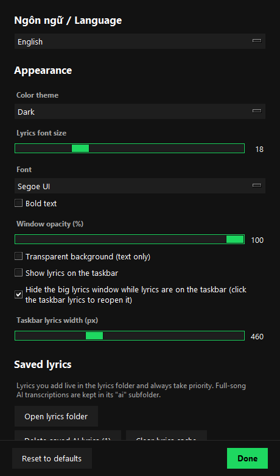

<p align="center">
  
</p>

# Lyric Spotify 🎶

A floating Windows overlay that shows **time-synced lyrics** for the song playing in the **Spotify desktop app**.
No Spotify login or API key needed. When no lyrics can be found, an optional **AI can listen and transcribe them** (NVIDIA GPU).

<p align="center">
  
</p>

## Features

- Reads the playing track from Windows Media Controls, so no Spotify developer account is needed.
- Synced lyrics from **NetEase Cloud Music** (great coverage of Vietnamese / Asian music) and **LRCLIB**, cached locally.
- **Lyrics on the taskbar**: the current line (and the next one) right on the Windows taskbar, next to the clock.
- The current line stays centered and scrolls smoothly; transparent "text only" mode; adjustable opacity, font and size.
- **Dark / light / follow-Windows** themes; Vietnamese and English interface.
- Add or fix lyrics yourself (right-click → *Add / edit lyrics*), saved as `.lrc` / `.txt` files.
- **AI transcription** (optional): Whisper large-v3-turbo on the GPU with Demucs vocal separation; lyrics appear as the song plays and are saved once the whole song has been heard.

| Lyrics window | Light theme | Settings |
|---|---|---|
|  |  |  |

**Lyrics on the taskbar**


## Download 

1. Go to **[Releases](https://github.com/KienChiNg/LyricSpotify/releases)** and download `LyricSpotify-Setup-<version>.exe` (~17 MB).
2. Run it. No administrator rights needed. You can optionally download the AI add-on during setup.
3. Open the Spotify desktop app and play a song.

> Windows may show a SmartScreen warning because the app is not code-signed yet:
> click **More info → Run anyway** (in Edge downloads: **… → Keep → Keep anyway**).

The AI add-on can also be installed later: ⚙ **Settings → AI transcription → Download AI add-on**
(~3 GB, +~2.5 GB with vocal separation, plus a ~1.6 GB speech model). Parts that are already on the PC are not downloaded again.
If the AI does not work, run `LyricSpotify.exe --selftest-ai`; the result is written to `~/.spotify_lyrics.log`.

## Usage

| Action | Result |
|---|---|
| Move the mouse over the window | Show buttons: ⚙ settings · 👁 transparent mode · ⋯ menu · — minimize · ☐ maximize · ✕ close |
| Drag inside the window | Move it |
| Drag any edge or corner | Resize it |
| Double-click the title bar | Maximize / restore |
| Double-click the lyrics / `T` key | Toggle the transparent background |
| Mouse wheel | Scroll through the lyrics (returns to the current line after 3 s) |
| `↑` `↓` | Window opacity |
| Right-click | Menu: settings, lyrics on the taskbar, add / edit lyrics, reload, lyrics folder, quit |
| `Esc` | Quit |

**Lyrics on the taskbar**: right-click → *Lyrics on the taskbar* (or in Settings). Drag the taskbar lyrics to move them;
click them to go back to the lyrics window.

## Run from source

### Requirements

- Windows 10 / 11 and the **Spotify** desktop app
- [Python 3.11+](https://www.python.org/downloads/) (tick *Add python.exe to PATH* when installing)
- For AI transcription: an **NVIDIA** GPU (6 GB+ VRAM recommended) and ~6 GB of free disk space

### Install

```bash
git clone https://github.com/KienChiNg/LyricSpotify.git
cd LyricSpotify
install.bat
```

`install.bat` installs the required packages, then asks whether to install the AI part (~3 GB) and Demucs vocal separation (~2.5 GB).
Or install manually:

```bash
pip install -r requirements.txt          # required
pip install -r requirements-ai.txt       # optional: AI transcription
pip install torch torchaudio --index-url https://download.pytorch.org/whl/cu124
pip install demucs                       # optional: vocal separation
```

### Run

Double-click `run.bat`, or run `pythonw spotify_lyrics.py`.

### Build the exe and installer

```bash
build.bat
```

This builds `dist\LyricSpotify.exe` with PyInstaller (AI libraries are intentionally **not** bundled; they are downloaded later)
and then `dist\LyricSpotify-Setup-<version>.exe` with [Inno Setup](https://jrsoftware.org/isinfo.php)
(`winget install --id JRSoftware.InnoSetup -e --scope user`).

## Notes on AI transcription

- Windows 10 cannot capture a single app's audio, so the AI **pauses while other apps are playing sound**.
  To capture only Spotify: install a virtual audio cable (e.g. VB-CABLE), set Spotify's output to *CABLE Input*,
  then select that device in *Settings → Device the AI listens to*.
- AI lyrics can contain mistakes; fix them with *Add / edit lyrics*. Your own saved lyrics always take priority.

## Data on your PC

| Path | Contents |
|---|---|
| `~/.spotify_lyrics.json` | Settings |
| `~/.spotify_lyrics_cache/` | Lyrics downloaded from the internet |
| `lyrics/`, `lyrics/ai/` (next to the app) | Lyrics you added / AI transcriptions |
| `%LOCALAPPDATA%\LyricSpotify\ai-libs` | AI add-on (removed by the uninstaller) |
| `~/.spotify_lyrics.log` | Error log |

## Lyrics sources

Lyrics come from NetEase Cloud Music and [LRCLIB](https://lrclib.net) through public (unofficial for NetEase) APIs.
Lyrics are the property of their respective owners; the app only displays them for personal use.
The demo images use made-up sample lyrics.
